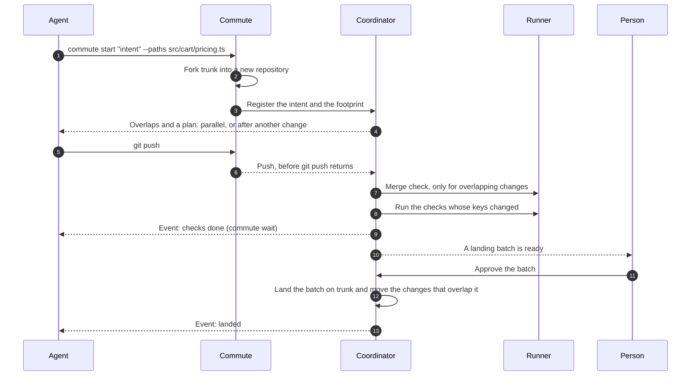
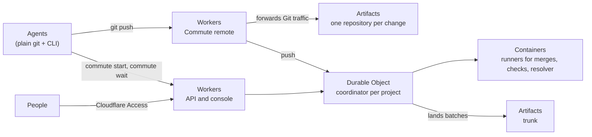

# Commute

**Changes that commute land in any order.**

Commute is a Git forge for teams that run many coding agents at the same time.
Each change gets its own repository. A coordinator watches every change in
flight. It tells agents at the start when their work overlaps, and it lands
independent changes in any order. Those changes keep their check results.

> Commute is a prototype. The scope of the first demo and the plan after it are
> in [PRD.md](PRD.md).

## Why agents need a different forge

The usual forge model comes from a time when people wrote every change. A
person had a few branches open. Checks and reviews attached to a commit. A
rebase was rare, and a merge conflict was a manual task. People told each other
when their work overlapped.

Agents change those numbers. A team can have hundreds of changes in flight. An
agent fixes a text conflict in about a minute. The cost moves to other places:

| Assumption from human-paced work | What happens with many agents | What Commute does |
|---|---|---|
| A few branches are in flight. | Hundreds of changes are in flight at once, from many agents. | One repository per change, and an index of the paths each change touches. |
| Checks and reviews attach to a commit, and rebases are rare. | Each landing rebases the changes above it, so their results go stale and run again. | Each result attaches to the content it checked. |
| Stacks put dependent work in order. | Most agent changes are independent, but a stack makes them wait anyway. | Changes run in parallel. They wait only when a real merge shows a conflict. |
| People resolve conflicts by hand. | Agents resolve text quickly, but they do not know why the other change exists. | A resolver agent gets the intent of both changes. Its resolution is stored for reuse. |
| People watch check pages. | Agents ask for status again and again. | Agents wait for events. |
| People tell each other about overlapping work. | Agents cannot talk to each other, so people pass the news. | The coordinator finds overlaps and shares each change's intent. |

## The ideas

### 1. One repository per change


`commute start` forks trunk into a new repository for the change. The agent
gets a Commute remote and a write token that expires after 60 minutes. The
Commute remote forwards Git traffic to the repository of the change, so the
coordinator sees each push as it happens. Agents never
share refs, a stash, or an index, so one agent cannot damage another agent's
work. Agents use plain `git clone`, `git commit`, and `git push`.

Only a landing writes to trunk.

### 2. Changes that commute


Two changes **commute** when applying them in either order gives the same tree.
Changes that edit different files always commute, so they can land in any
order. Two changes that edit the same lines do not commute. The order decides
the result, so Commute gives them an order.

This one rule replaces most stacks. A stack puts every change in a line. Commute
puts changes in order only when their order matters.

### 3. Lanes, not a line


In one line, every change waits for the change ahead of it, even when the two
changes touch nothing in common. Each landing also changes the base of the
changes behind it, so their checks run again.

In Commute, each area of the code works like its own lane. A change waits only
for changes that overlap it. A landing restarts checks only for the changes in
its lane. When every change touches the same files, the lanes become one line.
In practice that is rare.

### 4. Overlap is known at the start


A change declares the paths it will touch, its **footprint**, when it starts.
The coordinator keeps an index of every footprint in flight. After each push,
it measures the real footprint from the tree diff.

A new change is compared only with the changes that share one of its paths. For
those pairs, the coordinator runs a real three-way merge:

- If the merge is clean, both changes stay parallel.
- If the merge has a conflict, the new change waits for the older one. Each
  agent receives the other change's intent before it writes more code.

The number of possible pairs grows with the square of the changes in flight.
The number of merge checks grows only with real overlaps. This is how one
coordinator keeps up with a large fleet of agents.

### 5. Results follow content


Git already gives every folder in a commit its own hash. Commute uses that
hash. Each check declares the folders it reads, and its result is stored under
the hashes of those folders.

When trunk moves, Commute compares the hashes. A check runs again only when a
folder it reads has a new hash. A landing in `src/admin` runs no checks for a
change in `src/cart`. Keyed by commit, the same landing would run all of them.

### 6. Resolve once, with both intents


Some changes do collide. When the change ahead lands, Commute moves the change
behind it onto the new trunk. If a hunk conflicts, a resolver agent receives
three things: the hunk, and the intent of each change. It writes a resolution,
and the checks for the affected folders run on the result. No person is asked.

Commute stores the resolution under the hash of the conflict. When another
change hits the same conflict, the stored resolution applies, and the resolver
does not run.

### 7. People decide at the boundary

Agents do the work before a landing: they write code, run checks, and resolve
conflicts. A person decides what lands on trunk. Ready changes that commute
with each other form a **landing batch**, and one approval lands the whole
batch.

## The life of a change



## For a team

Commute treats every person's agents the same way. When Alice's change overlaps
Bob's change, the coordinator puts them in order and gives each agent the other
change's intent. Neither Alice nor Bob has to tell the other.

- Each change records its **owner**, the person who started it.
- The console has a "Mine" filter for your own changes.
- People sign in to the console with Cloudflare Access.
- Anyone on the team can approve a landing batch. Each landed commit records who
  approved it.

## How it is built

Commute runs on Cloudflare.



| Part | What it does |
|---|---|
| Artifacts | Holds trunk and one repository per change. It forks trunk for each change. |
| Durable Objects | Hold one coordinator per project: the footprint index, the order between changes, the result keys, and the landing queue. |
| Containers | Run the merge checks, the checks, and the resolver agent, from an image that includes Git. |
| Workers | Serve the API, the console, the Commute remote, and the events that agents wait for. |

## Using it

Agents need Git and two commands.

```console
$ commute start "Add tiered discounts to cart pricing" --paths src/cart/pricing.ts,config/discounts.json
change   c-157
remote   https://[commute-host]/git/storefront/c-157.git
overlap  c-142 (alice) on src/cart/pricing.ts
plan     after c-142

$ git push
$ commute wait
resolved conflict with c-142 resolved with both intents, stored as r-23
checks   1 kept, 4 ran again: src/cart and src/tax changed
ready    joins batch 43
```

## Glossary

| Term | Meaning |
|---|---|
| Change | One unit of work with an intent. It lives in its own repository, forked from trunk. |
| Intent | One or two sentences that say what a change is for. It is stored as a git note. |
| Owner | The person who started a change. |
| Footprint | The paths a change touches. |
| Trunk | The repository that changes land on. |
| Commute | Two changes commute when either order gives the same tree. |
| Overlap | Two changes in flight whose footprints meet. |
| Sequence | The order the coordinator sets between two changes that conflict. |
| Result | The outcome of a check, stored under the hashes of the folders the check reads. |
| Resolution | How a conflict was resolved, stored under the hash of the conflict. |
| Landing batch | Ready changes that commute with each other and with trunk. One approval lands the batch. |
| Coordinator | The process that holds the footprint index, the sequences, the result keys, and the landing queue for one project. |
| Event | A message from the coordinator: overlap found, check done, restacked, resolved, or landed. |

## Status

Commute is a prototype, and "Commute" is a working name.
[PRD.md](PRD.md) describes what the first demo covers and the features that
come after it.
