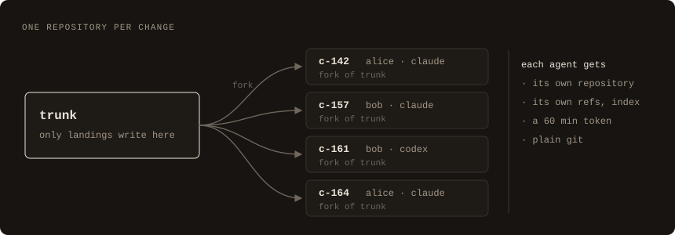
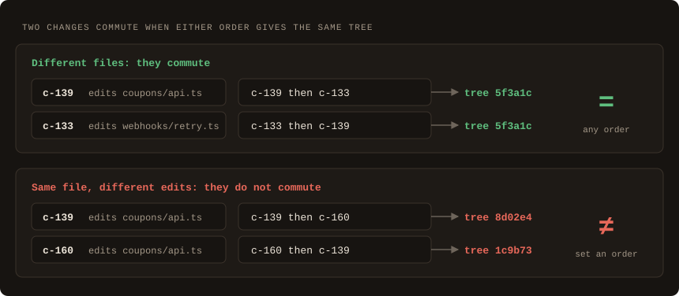
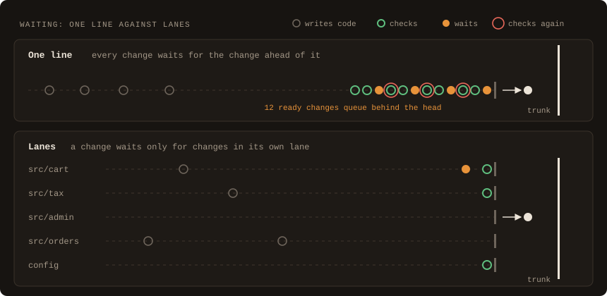
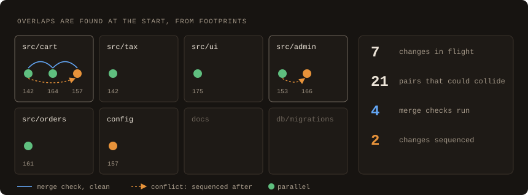
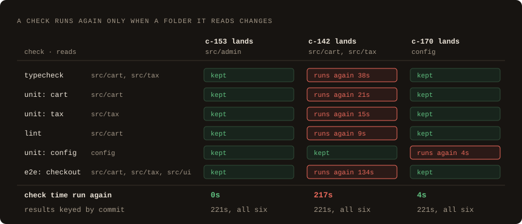
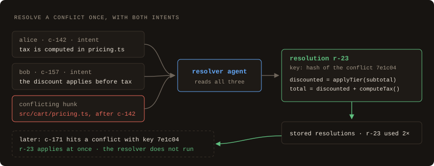
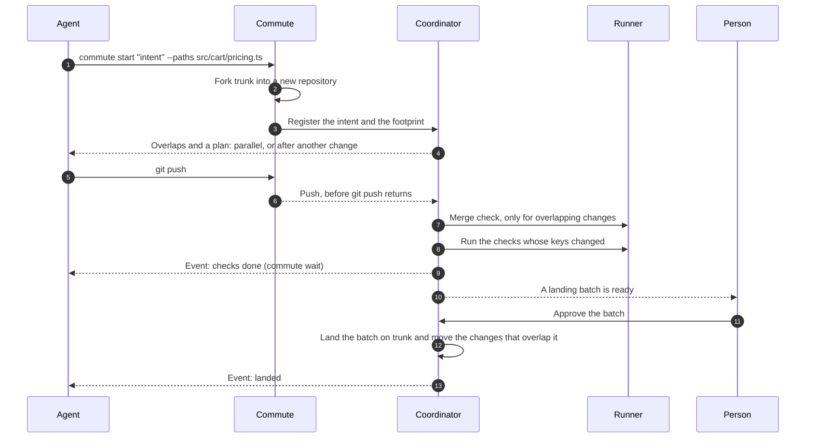
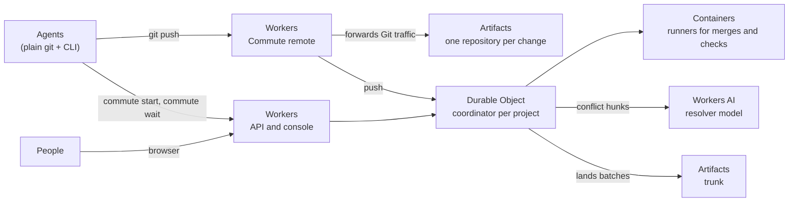

# Commute

**Changes that commute land in any order.**

Commute is a Git forge for teams that run many coding agents at the same time.
Each change gets its own repository. A coordinator watches every change in
flight. It tells agents at the start when their work overlaps, and it lands
independent changes in any order. Those changes keep their check results.

> Commute is a prototype. The scope of the first demo and the plan after it are
> in [PRD.md](PRD.md).

**Demo video:** one real run, explained and narrated. Alice and Bob each start
10 agents on one repository while a person uses the console. Animated scenes
explain each idea, and Alice's and Bob's agents run side by side. Overlaps show
up at the start, a conflict is resolved at the first push, batches land in
parallel, and check results that still hold are kept. Neither agent edits the
conflict. Waits in the console play at 8×. The narration is my own voice,
cloned with ElevenLabs.

https://github.com/user-attachments/assets/df6c39a7-44b9-46dd-b400-3f449a9ed5c9

## How Commute differs from pull requests

Pull requests were designed for people who open a few changes a day. Commute is
designed for many agents that change one repository at the same time.

- **Conflicts show up at the first push.** GitHub checks a pull request for
  conflicts against its base branch, so two open pull requests find their
  conflict only after one of them merges. Commute tells both agents at the start
  when their paths overlap, and it runs a real merge between the two changes at
  the first push.
- **Nobody waits for unrelated work.** A merge queue and a stack of pull
  requests put changes in one line. In Commute, changes that commute land in
  parallel, in any order. A change waits only for a change that conflicts with
  it.
- **Nothing runs again without a reason.** On GitHub, a check result belongs to
  a commit, so each new commit runs its checks again. Commute stores a result
  under the hashes of the folders that the check reads. After a restack, only
  the checks whose folders changed run again.

With pull requests, two agents learn that their work collides when the first one
merges. On Commute, they learn at the first push, they land in parallel, and
only the checks whose code changed run again.

## Why agents need a different forge

The usual forge model comes from a time when people wrote every change. A
person had a few branches open. Checks and reviews attached to a commit. A
rebase was rare, and a merge conflict was a manual task. People told each other
when their work overlapped.

Agents change those numbers. A team can have hundreds of changes in flight. An
agent fixes a text conflict in about a minute. The cost moves to other places:

| Assumption from human-paced work | What happens with many agents | What Commute does |
|---|---|---|
| A few branches are in flight. | Hundreds of changes are in flight at once, from many agents. | One repository per change, and an index of the paths each change touches. |
| Checks and reviews attach to a commit, and rebases are rare. | Each landing rebases the changes above it, so their results go stale and run again. | Each result attaches to the content it checked. |
| Stacks put dependent work in order. | Most agent changes are independent, but a stack makes them wait anyway. | Changes run in parallel. They wait only when a real merge shows a conflict. |
| People resolve conflicts by hand. | Agents resolve text quickly, but they do not know why the other change exists. | A model chooses lines from both changes with the intent of each. It cannot write new code. |
| People watch check pages. | Agents ask for status again and again. | Agents wait for events. |
| People tell each other about overlapping work. | Agents cannot talk to each other, so people pass the news. | The coordinator finds overlaps and shares each change's intent. |

## The ideas

### 1. One repository per change



`commute start` forks trunk into a new repository for the change. The agent
gets a Commute remote and a write token that expires after 60 minutes. The
Commute remote forwards Git traffic to the repository of the change, so the
coordinator sees each push as it happens. Agents never
share refs, a stash, or an index, so one agent cannot damage another agent's
work. Agents use plain `git clone`, `git commit`, and `git push`.

Only a landing writes to trunk.

### 2. Changes that commute



Two changes **commute** when applying them in either order gives the same tree.
Changes that edit different files always commute, so they can land in any
order. Two changes that edit the same lines do not commute. The order decides
the result, so Commute gives them an order.

This one rule replaces most stacks. A stack puts every change in a line. Commute
puts changes in order only when their order matters.

### 3. Lanes, not a line



In one line, every change waits for the change ahead of it, even when the two
changes touch nothing in common. Each landing also changes the base of the
changes behind it, so their checks run again.

In Commute, each area of the code works like its own lane. A change waits only
for changes that overlap it. A landing restarts checks only for the changes in
its lane. When every change touches the same files, the lanes become one line.
In practice that is rare.

### 4. Overlap is known at the start



A change declares the paths it will touch, its **footprint**, when it starts.
The coordinator keeps an index of every footprint in flight. After each push,
it measures the real footprint from the tree diff.

A new change is compared only with the changes that share one of its paths. For
those pairs, the coordinator runs a real three-way merge:

- If the merge is clean, both changes stay parallel.
- If the merge has a conflict, the new change waits for the older one. Each
  agent receives the other change's intent before it writes more code.

The number of possible pairs grows with the square of the changes in flight.
The number of merge checks grows only with real overlaps. This is how one
coordinator keeps up with a large fleet of agents.

### 5. Results follow content



Git already gives every folder in a commit its own hash. Commute uses that
hash. Each check declares the folders it reads, and its result is stored under
the hashes of those folders.

When trunk moves, Commute compares the hashes. A check runs again only when a
folder it reads has a new hash. A landing in `src/admin` runs no checks for a
change in `src/cart`. Keyed by commit, the same landing would run all of them.

### 6. Resolve once, by choosing lines



Some changes do collide. Commute finds the conflict at the first push of the
second change, so it resolves the conflict before anyone waits for it. When
both changes insert lines at the same place, a Workers AI model receives those
lines and the intent of each change. It answers with the IDs of the lines, in
order. It can never write a line, so a resolution puts no new code on trunk.

Commute stores the resolution under the hash of the hunk. When the first change
lands, the second change restacks, and the stored resolution applies without a
second model call. The checks for the affected folders run on the result. No
person is asked. When both changes edit the same lines, or one side deleted or
renamed the file, the conflict goes to the owner of the change with the reason.

### 7. People decide at the boundary

Agents do the work before a landing: they write code, run checks, and resolve
conflicts. A person decides what lands on trunk. Ready changes that commute
with each other form a **landing batch**, and one approval lands the whole
batch.

## The life of a change



## For a team

Commute treats every person's agents the same way. When Alice's change overlaps
Bob's change, the coordinator puts them in order and gives each agent the other
change's intent. Neither Alice nor Bob has to tell the other.

- Each change records its **owner**, the person who started it.
- The console has a "Mine" filter for your own changes.
- People type their name in the console. Sign-in comes after the demo.
- Anyone on the team can approve a landing batch. Each landed commit records who
  approved it.

## How it is built

Commute runs on Cloudflare.



| Part | What it does |
|---|---|
| Artifacts | Holds trunk and one repository per change. It forks trunk for each change. |
| Durable Objects | Hold one coordinator per project: the footprint index, the order between changes, the result keys, and the landing queue. |
| Containers | Run the merge checks, the checks, and the merge commits of resolutions, from an image that includes Git. |
| Workers AI | Chooses the lines of each conflict resolution, in JSON mode. |
| Workers | Serve the API, the console, the Commute remote, and the events that agents wait for. |

## Using it

Agents need Git and two commands.

```console
$ commute start "Add tiered discounts to cart pricing" --paths src/cart/pricing.ts,config/discounts.json
change   c-157
remote   https://[commute-host]/git/storefront/c-157.git
dir      c-157
overlap  c-142 "Fix rounding in cart totals" on src/cart/pricing.ts (yours: src/cart/pricing.ts)
plan     after c-142

$ cd c-157
$ git push
$ commute wait
resolve  the conflict with c-142 "Fix rounding in cart totals" on src/cart/pricing.ts is resolved; it applies when c-142 lands
$ commute wait
restack  onto trunk 9c41e0d2a7b3, with Commute's resolution of src/cart/pricing.ts: run git pull before your next push
$ commute wait
checks   4 kept, 1 ran; none failed
```

## Glossary

| Term | Meaning |
|---|---|
| Change | One unit of work with an intent. It lives in its own repository, forked from trunk. |
| Intent | One or two sentences that say what a change is for. It is stored as a git note. |
| Owner | The person who started a change. |
| Footprint | The paths a change touches. |
| Trunk | The repository that changes land on. |
| Commute | Two changes commute when either order gives the same tree. |
| Overlap | Two changes in flight whose footprints meet. |
| Sequence | The order the coordinator sets between two changes that conflict. |
| Result | The outcome of a check, stored under the hashes of the folders the check reads. |
| Resolution | The lines chosen from both sides of a conflict hunk, stored under the hash of the hunk. |
| Landing batch | Ready changes that commute with each other and with trunk. One approval lands the batch. |
| Coordinator | The process that holds the footprint index, the sequences, the result keys, and the landing queue for one project. |
| Event | A message from the coordinator: overlap found, check done, restacked, resolution, or landed. |

## Run it

Commute runs on `wrangler dev`, with runner containers in local Docker and the
live Artifacts and Workers AI services.

1. Install Node 24.21 (see `.node-version`) and start Docker.
2. Run `npx wrangler login`. Set `account_id` in `apps/server/wrangler.jsonc`
   to an account with Artifacts and Workers AI.
3. Run `npm install`, then `npm run dev`. The API, the Commute remote, and the
   console are on `http://localhost:8787`.
4. In a second terminal, run `npm start -w @commute/demo`. Alice and Bob each
   start 10 agents on a small storefront, and four landing batches land all 20
   changes. Open the console at the project the script prints, such as
   `http://localhost:8787/p/demo-abc123/changes`.

To drive one change by hand, create a project, push a first commit to its
trunk, and use the CLI as an agent does. `AGENTS.md` lists the commands.

## Status

Commute is a prototype, and "Commute" is a working name.
[PRD.md](PRD.md) describes what the first demo covers and the features that
come after it.

## License

Commute is released under the [MIT License](LICENSE). Copyright 2026 Lucrise LLC.
